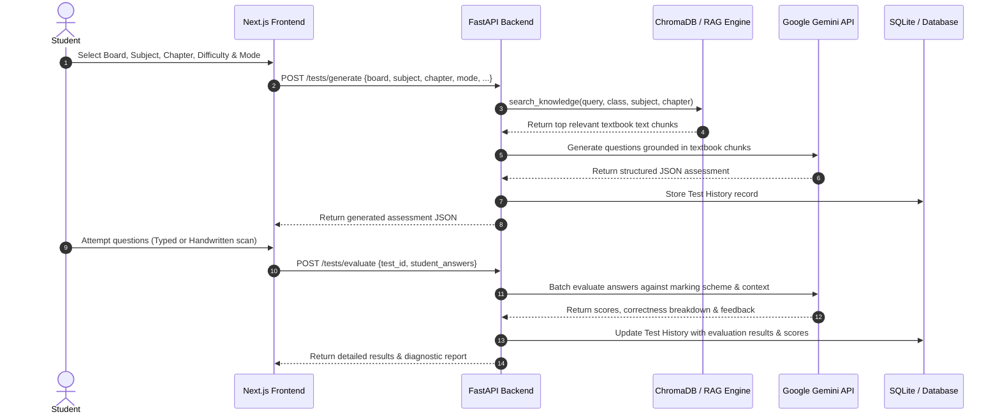
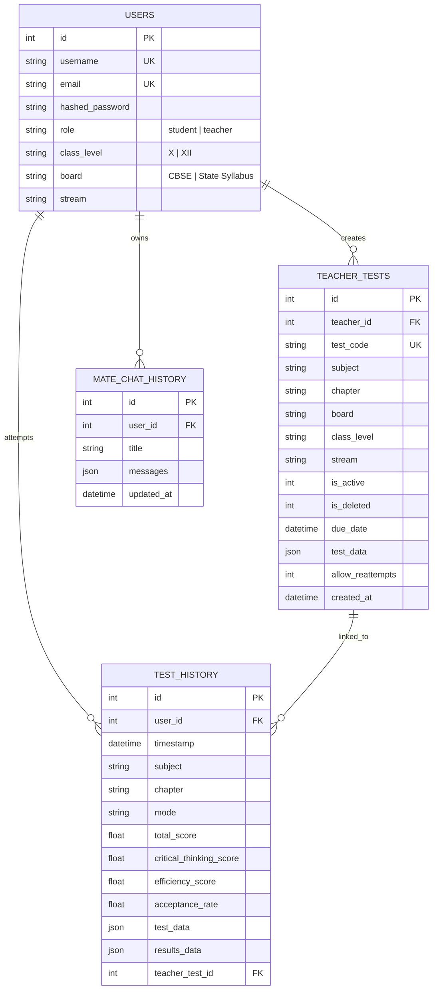

# AssessMate

```text
       _                               __  __       _       
      / \   ___ ___  ___  ___   ___   |  \/  | __ _| |_ ___  
     / _ \ / __/ __|/ _ \/ __|/  __|  | |\/| |/ _` | __/ _ \
    / ___ \\__ \__ \  __/\__  \\__  \ | |  | | (_| | ||  __/
   /_/   \_\___/___/\___| \___/ \___/ |_|  |_|\__,_|\__\___|

```

> **AI-Powered Assessment, Practice, and Diagnostic Learning Platform for CBSE & State Syllabus Students and Teachers.**

---

[](https://fastapi.tiangolo.com/)
[](https://nextjs.org/)
[](https://www.python.org/)
[](https://www.typescriptlang.org/)
[](https://tailwindcss.com/)
[](https://ai.google.dev/)
[](https://www.trychroma.com/)
[](LICENSE)

---

## 📋 Table of Contents

1. [About AssessMate](#1-about-assessmate)
2. [The Problem](#2-the-problem)
3. [The Solution](#3-the-solution)
4. [Key Features](#4-key-features)
5. [Product Showcase](#5-product-showcase)
6. [How AssessMate Works](#6-how-assessmate-works)
7. [Test Modes & Question Allocations](#7-test-modes--question-allocations)
8. [CBSE & State Syllabus Integration](#8-cbse--state-syllabus-integration)
9. [AI Architecture & Pipeline](#9-ai-architecture--pipeline)
10. [Retrieval-Augmented Generation (RAG) System](#10-retrieval-augmented-generation-rag-system)
11. [AI Answer Evaluation Engine](#11-ai-answer-evaluation-engine)
12. [System Architecture](#12-system-architecture)
13. [Backend Architecture & Routers](#13-backend-architecture--routers)
14. [Frontend Architecture & Components](#14-frontend-architecture--components)
15. [Database Architecture & Schemas](#15-database-architecture--schemas)
16. [Project Structure](#16-project-structure)
17. [Technology Stack](#17-technology-stack)
18. [Installation & Prerequisites](#18-installation--prerequisites)
19. [Environment Variables Configuration](#19-environment-variables-configuration)
20. [Running the Application](#20-running-the-application)
21. [API Reference & Endpoints](#21-api-reference--endpoints)
22. [Authentication & Authorization](#22-authentication--authorization)
23. [Student Workflow](#23-student-workflow)
24. [Teacher Workflow](#24-teacher-workflow)
25. [Deployment Architecture](#25-deployment-architecture)
26. [Production Engineering Challenges](#26-production-engineering-challenges)
27. [Security Best Practices](#27-security-best-practices)
28. [Limitations](#28-limitations)
29. [Known Issues & Workarounds](#29-known-issues--workarounds)
30. [Development Journey & Story](#30-development-journey--story)
31. [Design Philosophy](#31-design-philosophy)
32. [Project Roadmap](#32-project-roadmap)
33. [Testing & Quality Assurance](#33-testing--quality-assurance)
34. [AI Reliability & Anti-Hallucination Controls](#34-ai-reliability--anti-hallucination-controls)
35. [Frequently Asked Questions (FAQ)](#35-frequently-asked-questions-faq)
36. [Contributing](#36-contributing)
37. [Credits](#37-credits)
38. [Acknowledgements](#38-acknowledgements)
39. [License](#39-license)
40. [Contact & Final Statement](#40-contact--final-statement)

---

## 1. About AssessMate

**AssessMate** is an advanced, AI-integrated assessment, diagnostic practice, and performance analytics platform designed specifically for students and educators following **CBSE** and **State Syllabus** curricula (Classes X & XII).

Built around the principle that **assessment should be a diagnostic tool for learning rather than a mere final mark**, AssessMate creates a closed feedback loop:

$$\text{Generate} \longrightarrow \text{Attempt} \longrightarrow \text{Evaluate} \longrightarrow \text{Analyze} \longrightarrow \text{Improve}$$

The platform enables students to generate textbook-grounded assessments across multiple difficulty tiers and test modes, write typed or handwritten answers, receive automated AI evaluations with itemized breakdown scores, and receive real-time contextual help through an embedded AI study assistant named **Mate**. For teachers, AssessMate provides test curation tools, customized test duration controls, unique 6-digit access codes, and automated submission evaluation.

---

## 2. The Problem

Traditional educational testing platforms suffer from structural limitations:

```text
Traditional Model:
Question ──► Answer ──► Raw Score ──► Done (No actionable insight)
```

### Key Shortcomings of Existing Solutions:
- **Superficial Feedback**: Students receive raw numerical marks without understanding whether errors stemmed from conceptual gaps, calculation errors, key formula omissions, or vocabulary issues.
- **Generic AI Question Generators**: Standard LLM test generators suffer from hallucinations and fail to stick closely to prescribed NCERT or State Board textbook standards.
- **Manual Teacher Overhead**: Creating quality diagnostic assessments with mixed question types (MCQs, short answers, case studies, long answers) demands hours of manual effort.
- **Fragmented Performance History**: Student progress is tracked in static spreadsheets or separate tools, masking trend lines in accuracy, efficiency, and critical thinking.
- **Rigid Answer Formats**: Most digital platforms only support standard multiple-choice questions, ignoring subjective, multi-step problem solving and handwritten submissions.

---

## 3. The Solution

AssessMate transforms assessment into an interactive learning process:

```text
AssessMate Model:
Selection ──► RAG Context Retrieval ──► Grounded Question Generation
     │
     ▼
Student Attempt (Typed / Handwritten) ──► Multi-criteria AI Evaluation
     │
     ▼
Diagnostic Breakdown (Accuracy, Efficiency, Critical Thinking) ──► Personalized AI Remediation
```

### How AssessMate Solves the Problem:
- **Textbook-Grounded Question Generation**: Questions are retrieved directly from indexed NCERT and State Board textbook PDFs using vector similarity search before generation.
- **Multi-Format Evaluation**: Evaluates multiple-choice options, typed subjective answers, and handwritten answer sheet scans.
- **Granular Diagnostic Metrics**: Scores performance across total marks, accuracy percentage, time-efficiency index, and critical-thinking competency.
- **Teacher Governance**: Enables teachers to create tests with access codes, expiration windows, and reattempt toggles.
- **In-Exam Assistance**: Integrated **Mate AI Chat** provides step-by-step hinting without spoiling the direct solution.

---

## 4. Key Features

### 🤖 AI Test Generation
- Generate custom tests filtered by **Board** (CBSE / State Syllabus), **Class** (X / XII), **Subject**, **Chapter**, **Subtopic**, **Difficulty**, and **Exam Mode**.
- Formats include MCQs (1 Mark), Short Answers (2 & 3 Marks), Case Studies (4 Marks), and Long Answers (5 Marks).

### 📚 Textbook-Grounded RAG Pipeline
- Grounded in NCERT and State Board PDF textbooks.
- Uses `BAAI/bge-small-en-v1.5` embeddings and **ChromaDB Cloud** to retrieve relevant context chunks before passing prompts to Google Gemini models.

### ✍️ Answer Evaluation Engine
- Evaluates objective MCQs as well as subjective answers.
- Performs automated image-based handwritten answer sheet processing using Gemini's multimodal vision features.
- Provides itemized feedback: correctness, missing points, key formula verification, and constructive suggestions.

### 📊 Performance & Diagnostic Dashboard
- Interactive analytics dashboard built with Recharts.
- Tracks score history, accuracy percentages, efficiency ratings, critical-thinking scores, and total completed assessments.

### 👨‍🏫 Teacher Portal & Access Code Engine
- Teachers can create custom tests, configure expiration dates (`due_date`), enable/disable reattempts, and generate unique 6-digit access codes.
- Teachers can review student test submissions and AI-graded evaluation reports.

### 💬 Mate AI Study Assistant
- In-exam contextual AI chat assistant.
- Delivers hints, explains core concepts, and guides student thinking without directly solving test questions.

---

## 5. Product Showcase

The project repository includes visual assets inside the `Showcase/` directory:

| Feature / Interface | Visual Asset |
| :--- | :--- |
| **Student Dashboard & Analytics** | `Showcase/Screenshot 2026-04-29 213353.png` |
| **AI Test Builder Configuration** | `Showcase/Screenshot 2026-04-29 213436.png` |
| **Question Attempt Interface & Mate Chat** | `Showcase/Screenshot 2026-04-29 213521.png` |
| **Evaluation & Feedback Screen** | `Showcase/Screenshot 2026-04-29 213546.png` |
| **Teacher Portal & Assessment Management** | `Showcase/Screenshot 2026-04-29 213813.png` |
| **Digital Textbook Viewer** | `Showcase/Screenshot 2026-04-29 215231.png` |

---

## 6. How AssessMate Works



---

## 7. Test Modes & Question Allocations

AssessMate offers four configured assessment modes:

| Test Mode | MCQ (1 Mark) | Short (2 Marks) | Short (3 Marks) | Case Study (4 Marks) | Long (5 Marks) | Total Questions | Total Marks |
| :--- | :---: | :---: | :---: | :---: | :---: | :---: | :---: |
| **Main Exam Mode** | 20 | 6 | 7 | 3 | 3 | **39** | **80** |
| **MCQ Only Mode** | 20 | 0 | 0 | 0 | 0 | **20** | **20** |
| **Balanced Mode** | 5 | 3 | 0 | 0 | 1 | **9** | **16** |
| **Custom Mode** | User-defined | User-defined | 0 | 0 | User-defined | **Dynamic** | **Dynamic** |

> ⚠️ **Curriculum Note**: These presets represent AssessMate's configured assessment structures for diagnostic practice. They are not intended as an official replacement for formal board examination question papers issued by CBSE or State Boards.

---

## 8. CBSE & State Syllabus Integration

AssessMate treats curriculum context as a first-class feature of the retrieval pipeline:

```text
                              ┌──────────────────────┐
                              │  Curriculum Selector │
                              └──────────┬───────────┘
                                         │
                    ┌────────────────────┴────────────────────┐
                    ▼                                         ▼
         ┌─────────────────────┐                   ┌─────────────────────┐
         │     CBSE Board      │                   │    State Syllabus   │
         │  (Class X & XII)    │                   │   (Class X & XII)   │
         └──────────┬──────────┘                   └──────────┬──────────┘
                    │                                         │
                    ▼                                         ▼
         ┌─────────────────────┐                   ┌─────────────────────┐
         │   NCERT Textbook    │                   │ State Board Text    │
         │   PDF Knowledge     │                   │   PDF Knowledge     │
         └──────────┬──────────┘                   └──────────┬──────────┘
                    │                                         │
                    └────────────────────┬────────────────────┘
                                         ▼
                              ┌──────────────────────┐
                              │  ChromaDB RAG Engine │
                              └──────────────────────┘
```

The selected curriculum determines which textbook collection is queried during the RAG phase, ensuring that terminology, definitions, and problem setups align with the student's specific academic board.

---

## 9. AI Architecture & Pipeline

AssessMate uses **Google Gemini models** (`gemini-2.5-flash`, `gemini-2.5-flash-lite`, `gemini-3.5-flash`, `gemini-3.5-flash-lite`) integrated via the `google-genai` SDK.

```text
                             ┌───────────────────────┐
                             │  Question Generator   │
                             └──────────┬────────────┘
                                        │
             ┌──────────────────────────┼──────────────────────────┐
             ▼                          ▼                          ▼
  ┌─────────────────────┐    ┌─────────────────────┐    ┌─────────────────────┐
  │   Model Fallback    │    │  Strict JSON Schema │    │ Prompt Grounding    │
  │   Rotation Chain    │    │   Enforcement       │    │ System Prompts      │
  └─────────────────────┘    └─────────────────────┘    └─────────────────────┘
```

### Robustness & Fallback Strategy:
1. **Fallback Rotation**: If a primary Gemini model encounters rate limits (HTTP 429) or endpoint errors (HTTP 404), `gemini_service.py` automatically iterates through configured fallback models.
2. **Key Rotation**: Supports multiple Gemini API keys (`GEMINI_API_KEY`, `GEMINI_API_KEY_2`, `GEMINI_API_KEY_3`) to maintain uptime during high traffic.
3. **Structured JSON Output**: All prompts enforce strict JSON formatting rules to prevent parsing errors when rendering question cards in the Next.js UI.

---

## 10. Retrieval-Augmented Generation (RAG) System

AssessMate implements an end-to-end RAG architecture in `backend/rag.py`:

```text
[PDF Textbooks] ──► [Chunking Engine] ──► [BAAI/bge-small-en Embeddings] ──► [ChromaDB Cloud]
                                                                                    │
[User Search Query] ──► [Query Embedding] ─────────────────────────── Query Vector Search
                                                                                    │
                                                                                    ▼
                                                                        [Top Context Chunks]
```

### Technical Specifications:
- **Embedding Model**: `BAAI/bge-small-en-v1.5` (via `sentence-transformers`).
- **Vector Database**: **ChromaDB Cloud** / Local persistent Chroma store.
- **Chunking Parameters**:
  - Chunk Size: ~500 tokens
  - Chunk Overlap: ~50 tokens
- **Metadata Indexing**: Every vector chunk is tagged with metadata fields: `class_level`, `subject`, `chapter`, and `board`.

---

## 11. AI Answer Evaluation Engine

AssessMate's evaluation pipeline processes student submissions through two distinct workflows:

### 1. Objective MCQs
- Evaluated instantaneously via exact key comparison.
- Provides explanation text retrieved from the question generation output.

### 2. Subjective / Handwritten Answers
- Evaluated via Gemini LLM using contextual evaluation prompts.
- Multi-criteria evaluation rubric:
  - **Conceptual Accuracy** (60% weight): Verifies correct principles and reasoning.
  - **Completeness & Key Points** (20% weight): Checks for required keywords, diagrams, or formula steps.
  - **Clarity & Terminology** (20% weight): Assesses academic vocabulary and formatting.

---

## 12. System Architecture

```text
┌───────────────────────────────────────────────────────────────────────────┐
│                              CLIENT BROWSER                               │
│                   Next.js 14 Web UI (TypeScript + React)                  │
└─────────────────────────────────────┬─────────────────────────────────────┘
                                      │ REST API Calls (HTTP / JSON)
                                      ▼
┌───────────────────────────────────────────────────────────────────────────┐
│                             FASTAPI BACKEND                               │
│   ┌───────────────┬───────────────┬───────────────┬───────────────────┐   │
│   │ Auth Router   │ Test Router   │ Chat Router   │ Textbook Router   │   │
│   └───────┬───────┴───────┬───────┴───────┬───────┴─────────┬─────────┘   │
└───────────┼───────────────┼───────────────┼─────────────────┼─────────────┘
            │               │               │                 │
            ▼               ▼               ▼                 ▼
   ┌─────────────────┐ ┌─────────┐ ┌─────────────────┐ ┌──────────────┐
   │ SQLite Database │ │ Gemini  │ │ ChromaDB Cloud  │ │  Resources   │
   │  (SQLAlchemy)   │ │ AI API  │ │  (RAG Vectors)  │ │ (PDF Files)  │
   └─────────────────┘ └─────────┘ └─────────────────┘ └──────────────┘
```

---

## 13. Backend Architecture & Routers

The backend is built with **FastAPI** (`backend/main.py`) following a modular router architecture:

```text
backend/
├── main.py                   # App entrypoint, CORS setup, router mounting
├── database.py               # SQLAlchemy Engine & SessionLocal setup
├── models.py                 # DB entities (User, TestHistory, TeacherTest, MateChatHistory)
├── schemas.py                # Pydantic models for request/response validation
├── gemini_service.py         # AI question generation, evaluation, & model rotation
├── rag.py                    # RAG search engine & ChromaDB vector connection
├── Procfile                  # Uvicorn production server process definition
├── requirements.txt          # Python package manifest
└── routers/
    ├── auth.py               # POST /auth/register, POST /auth/login
    ├── test.py               # POST /tests/generate, POST /tests/evaluate, GET /tests/history
    ├── chat.py               # POST /chat/mate (Mate AI study assistant)
    ├── textbooks.py          # GET /textbooks (PDF catalog and textbook serving)
    └── admin.py              # GET /admin/stats (Platform statistics and analytics)
```

---

## 14. Frontend Architecture & Components

The frontend is built using **Next.js 14 App Router** with **TypeScript** and **Tailwind CSS**:

```text
frontend/src/
├── app/
│   ├── layout.tsx            # Global root layout, font loading, navbar header
│   ├── page.tsx              # Landing page with hero banner & feature highlights
│   ├── globals.css           # Custom CSS, glassmorphism utilities, KaTeX overrides
│   ├── login/page.tsx        # User authentication portal (Login / Register)
│   ├── dashboard/page.tsx    # Student performance dashboard & test history
│   ├── test-builder/page.tsx # Test generator configuration interface
│   ├── test/[id]/page.tsx    # Interactive test execution interface & timer
│   ├── results/[id]/page.tsx # Diagnostic evaluation output & feedback sheet
│   └── teacher/page.tsx      # Teacher test curation & student results viewer
├── components/
│   ├── MarkdownRenderer.tsx  # Custom KaTeX math formula & markdown renderer
│   ├── Navbar.tsx            # Application navigation bar
│   └── MateChat.tsx          # Embedded AI study assistant drawer
└── config/
    └── api.ts                # Parameterized API_BASE_URL (Production vs Local)
```

---

## 15. Database Architecture & Schemas

AssessMate uses **SQLite** with **SQLAlchemy ORM** (`backend/models.py`):



---

## 16. Project Structure

```text
AssessMate/
├── backend/                  # FastAPI Backend Server
│   ├── routers/              # API Route Modules (auth, test, chat, textbooks, admin)
│   ├── database.py           # SQLite Database Connection Setup
│   ├── models.py             # SQLAlchemy Data Models
│   ├── schemas.py            # Pydantic Schemas
│   ├── gemini_service.py     # Gemini AI Generation & Evaluation Integration
│   ├── rag.py                # ChromaDB Vector Search Engine
│   ├── main.py               # FastAPI App Gateway
│   ├── Procfile              # Render Web Service Process Controller
│   └── requirements.txt      # Python Dependencies
├── frontend/                 # Next.js 14 React Application
│   ├── src/
│   │   ├── app/              # Next.js App Router Pages
│   │   ├── components/       # UI Components (MarkdownRenderer, MateChat, etc.)
│   │   └── config/           # Environment API configuration (api.ts)
│   ├── public/               # Public Images & Static Assets
│   ├── package.json          # Node Dependencies & Build Scripts
│   └── tsconfig.json         # TypeScript Configuration
├── Resources/                # PDF Textbook Repository
│   ├── CBSE/                 # Class X & XII NCERT Textbooks
│   └── State Board/          # State Board Textbook Collection
├── Showcase/                 # Visual Screenshots & Demo Images
├── curriculum.json           # Subject, Class, and Chapter Mapping Dataset
├── run.bat                   # Windows One-Click Launch Automation Batch Script
├── explaination.md           # Technical Repository Structure Documentation
└── README.md                 # Project Master Documentation
```

---

## 17. Technology Stack

| Category | Technology | Version | Purpose |
| :--- | :--- | :--- | :--- |
| **Frontend Framework** | Next.js | 14.x | React App Router framework for client UI |
| **Language (Frontend)** | TypeScript | 5.x | Static typing across all components & API interfaces |
| **Styling & Design** | Tailwind CSS | 3.4.x | Utility-first styling & responsive layouts |
| **Math Rendering** | KaTeX / react-katex | 0.16.x | Render LaTeX math notation inline and block |
| **Backend Framework** | FastAPI | 0.110.x | Async REST API microservice framework |
| **Language (Backend)** | Python | 3.10+ | Core server runtime |
| **Database** | SQLite | 3.x | Lightweight relational storage for users & tests |
| **ORM** | SQLAlchemy | 2.0.x | Relational mapping & query building |
| **AI LLM Engine** | Google Gemini API | 2.5 / 3.5 | Question generation, evaluation & vision OCR |
| **Vector Database** | ChromaDB Cloud | 0.4.x | Storing and searching embedded textbook chunks |
| **Embedding Model** | BAAI/bge-small-en-v1.5 | 1.5 | Vectorizing text for RAG retrieval |
| **Authentication** | Passlib / PyJWT | 2.8.x | Password hashing and JWT access token handling |

---

## 18. Installation & Prerequisites

### Prerequisites
Before running AssessMate locally, ensure you have installed:
- **Node.js**: `v18.x` or `v20.x`
- **Python**: `v3.10`, `v3.11`, or `v3.12`
- **Git**: Latest release
- **Google Gemini API Key**: Obtainable from [Google AI Studio](https://aistudio.google.com/)

---

## 19. Environment Variables Configuration

Create a `.env` file inside the `backend/` directory and set your API keys:

```env
# Backend Environment Configuration (backend/.env)

# Required: Google Gemini API Key
GEMINI_API_KEY=your_gemini_api_key_here
GEMINI_API_KEY_2=optional_secondary_gemini_key
GEMINI_API_KEY_3=optional_tertiary_gemini_key

# Optional: ChromaDB Cloud Vector Database Credentials
CHROMA_API_KEY=your_chroma_api_key_here
CHROMA_TENANT=default_tenant
CHROMA_DATABASE=default_database

# JWT Security Configuration
SECRET_KEY=assessmate_super_secret_jwt_key_2026
ALGORITHM=HS256
ACCESS_TOKEN_EXPIRE_MINUTES=43200
```

Create a `.env.local` file inside the `frontend/` directory:

```env
# Frontend Environment Configuration (frontend/.env.local)

# Backend API Endpoint URL
NEXT_PUBLIC_API_URL=http://127.0.0.1:8000
```

---

## 20. Running the Application

### Method 1: One-Click Startup (Windows)
Run the batch file in the root directory:

```powershell
.\run.bat
```
This batch script activates the Python environment, starts the FastAPI server at `http://127.0.0.1:8000`, and launches the Next.js dev server at `http://localhost:3000`.

---

### Method 2: Manual Terminal Execution

#### Terminal 1: Launch Backend
```bash
cd backend
python -m venv venv
# On Windows:
.\venv\Scripts\activate
# On Linux/macOS:
source venv/bin/activate

pip install -r requirements.txt
uvicorn main:app --reload --host 127.0.0.1 --port 8000
```

#### Terminal 2: Launch Frontend
```bash
cd frontend
npm install
npm run dev
```

Open your browser and navigate to `http://localhost:3000`.

---

## 21. API Reference & Endpoints

| Method | Endpoint | Description | Auth Required |
| :--- | :--- | :--- | :---: |
| `POST` | `/auth/register` | Register a new student or teacher account | No |
| `POST` | `/auth/login` | Authenticate user & return JWT Bearer token | No |
| `POST` | `/tests/generate` | Generate RAG-grounded assessment JSON | Yes |
| `POST` | `/tests/evaluate` | Submit student answers for AI evaluation | Yes |
| `GET` | `/tests/history` | Retrieve student test history & scores | Yes |
| `POST` | `/tests/teacher/create` | Crate a teacher test & generate 6-digit access code | Yes |
| `GET` | `/tests/teacher/list` | Retrieve tests created by the active teacher | Yes |
| `POST` | `/chat/mate` | Send message to Mate AI study assistant | Yes |
| `GET` | `/textbooks` | Retrieve available digital textbook list | No |
| `GET` | `/health` | Server health check endpoint | No |

---

## 22. Authentication & Authorization

AssessMate uses **JWT (JSON Web Tokens)** for stateless user authentication.
- Passwords are hashed securely using **Passlib** with `sha256_crypt`.
- Tokens are stored client-side in `localStorage` and sent via the `Authorization: Bearer <token>` header.
- Roles (`student`, `teacher`) restrict access to protected views (e.g., teacher assessment creation page vs. student dashboard).

---

## 23. Student Workflow

```text
Step 1: Sign up / Log in to Student Dashboard
Step 2: Navigate to "Build a Test"
Step 3: Select Class (X/XII), Board (CBSE/State), Subject, & Chapter
Step 4: Select Test Mode (Main Exam / MCQ / Balanced / Custom)
Step 5: Click "Generate Test" (RAG fetches context and generates questions)
Step 6: Attempt questions (Typed responses or Image upload for handwritten sheets)
Step 7: Submit test for AI Evaluation
Step 8: View Diagnostic Results (Score, Accuracy, Efficiency, & Explanations)
```

---

## 24. Teacher Workflow

```text
Step 1: Log in with a Teacher Account
Step 2: Access Teacher Portal
Step 3: Click "Create Assessment"
Step 4: Select Target Board, Class, Subject, and Question Types
Step 5: Set Assessment Expiration Date & Reattempt Limits
Step 6: Publish Test & Receive Unique 6-Digit Access Code (e.g., `839201`)
Step 7: Distribute code to students
Step 8: Track student submissions and view AI-generated answer evaluation sheets
```

---

## 25. Deployment Architecture

AssessMate is designed for decoupled hosting:

```text
               ┌───────────────────────────────┐
               │         VERCEL CLOUD          │
               │   Next.js 14 Frontend App     │
               │   assessmate.vercel.app       │
               └───────────────┬───────────────┘
                               │
                      HTTPS REST API Calls
                               │
                               ▼
               ┌───────────────────────────────┐
               │         RENDER CLOUD          │
               │    FastAPI Python Service     │
               │    assessmate-api.onrender.com│
               └───────────────────────────────┘
```

- **Frontend**: Deployed to Vercel with `NEXT_PUBLIC_API_URL` pointing to the production FastAPI endpoint.
- **Backend**: Deployed to Render as a Web Service using `backend/Procfile`:
  ```text
  web: uvicorn main:app --host 0.0.0.0 --port $PORT
  ```

---

## 26. Production Engineering Challenges

### Render Memory Limit (512MB RAM Bottleneck)
During cloud deployment on Render's free tier (512MB RAM limit), the backend service encountered an Out-Of-Memory (OOM) error on startup:

```text
Out of memory (used over 512MB) while running your code.
```

#### Technical Root Cause Analysis:
- The local RAG module imported `sentence-transformers` to load the `BAAI/bge-small-en-v1.5` model.
- `sentence-transformers` automatically pulls down `torch` (PyTorch), `transformers`, and `scipy`, creating a memory baseline of **~650MB – 1.1GB RAM** upon server initialization.
- This exceeds Render's 512MB memory ceiling.

#### Proposed Optimization Strategies (Investigated):

```text
Strategy 1: Cloud API Embeddings (Recommended)
Replace PyTorch / sentence-transformers with direct Gemini Embedding API (`genai.embed_content`).
  ├── Memory Footprint: Reduced from 750MB to ~60MB RAM
  └── Requirements: Remove PyTorch and sentence-transformers from requirements.txt

Strategy 2: Lightweight ONNX Runtime
Replace PyTorch runtime with `optimum` ONNX runtime for sentence-transformers.
  └── Memory Footprint: Reduced to ~180MB RAM

Strategy 3: Lazy Model Loading
Defer RAG module initialization until a user specifically requests test generation.
  └── Memory Footprint: Fast cold-start (~50MB), loads model on-demand.
```

---

## 27. Security Best Practices

- **Zero Hardcoded Secrets**: Secrets and API keys are stored exclusively in `.env` files which are excluded via `.gitignore`.
- **ORMs for SQL Injection Prevention**: All queries use SQLAlchemy parameter binding.
- **Strict Input Validation**: Pydantic schemas validate all incoming requests.
- **CORS Middleware Isolation**: Restricts cross-origin resource access.

---

## 28. Limitations

- **Probabilistic AI Output**: AI-generated questions and evaluations can occasionally exhibit minor variations in grading strictness.
- **Free Tier Cold Starts**: When hosted on Render's free tier, the backend web service spins down during inactivity, causing an initial request delay of ~50 seconds.
- **Handwritten Image Quality**: Handwritten answer sheet OCR depends on image lighting and clarity.

---

## 29. Known Issues & Workarounds

- **Render Memory Failure**: Solved by switching from PyTorch `sentence-transformers` to Gemini cloud embeddings (`genai.embed_content`) when building for 512MB cloud environments.
- **Deprecation of Older Gemini Models**: Updated `gemini_service.py` to use active models (`gemini-2.5-flash`, `gemini-3.5-flash`) with dynamic model rotation on HTTP 404/429 errors.

---

## 30. Development Journey & Story

AssessMate evolved from a simple prototype into a diagnostic learning platform:

```text
Phase 1: Basic AI Question Generator (LLM prompt wrapper)
Phase 2: RAG Pipeline Integration (Grounding questions in NCERT PDFs via ChromaDB)
Phase 3: Multi-format Answer Evaluation (Adding typed & handwritten vision grading)
Phase 4: Diagnostic Metrics (Adding Accuracy, Efficiency, & Critical Thinking scores)
Phase 5: Teacher Management Engine (Access codes, expiration windows, & submission reviews)
Phase 6: Infrastructure Optimization & Cloud Deployment Prep
```

---

## 31. Design Philosophy

- **Academic Clarity**: Clean typography, dark mode glassmorphism, and minimal visual noise.
- **Mathematical Precision**: Formatted KaTeX rendering ensures fractions, chemical equations, and square roots display cleanly without HTML tag leakage.
- **Actionable Feedback**: Replaces raw scores with detailed feedback and diagnostic metric indicators.

---

## 32. Project Roadmap

- [x] RAG-Grounded Test Generation for CBSE & State Boards
- [x] Multi-Mode Test Presets (Main Exam, MCQ, Balanced, Custom)
- [x] AI Answer Evaluation with Itemized Rubrics
- [x] Handwritten Answer OCR Vision Processing
- [x] Teacher Test Curation & 6-Digit Access Code Engine
- [x] Mate AI In-Exam Study Assistant
- [ ] Adaptive Testing Engine (Dynamic difficulty adjustment based on answer streak)
- [ ] Multi-Language Support (Hindi & Tamil medium textbook grounding)
- [ ] Mobile App (React Native build)

---

## 33. Testing & Quality Assurance

- **API Endpoint Verification**: Verified using FastAPI Swagger UI (`/docs`).
- **LaTeX Math Rendering Verification**: Validated rendering of mathematical formulas across fractions, exponents, and chemical symbols.
- **Test Generation Balance Verification**: Tested question output balance across 80-mark, 20-mark, and 16-mark test presets.

---

## 34. AI Reliability & Anti-Hallucination Controls

To prevent AI hallucinations, AssessMate uses:
1. **RAG Context Constraints**: System prompts instruct Gemini models to restrict factual assertions to retrieved textbook text.
2. **Schema Validation**: Output must strictly match predefined Pydantic JSON schemas.
3. **Structured System Prompts**: Explicit grading rubrics define expectations for full marks vs partial marks.

---

## 35. Frequently Asked Questions (FAQ)

#### Q: Is AssessMate strictly for CBSE students?
**A:** No. AssessMate supports both **CBSE** and **State Board** curricula for Classes X and XII.

#### Q: How does AssessMate handle handwritten answers?
**A:** Students can upload a photograph or scan of their handwritten answer sheet. The image is passed to Gemini Vision models for OCR processing and evaluated against the question's mark scheme.

#### Q: How do teacher access codes work?
**A:** When a teacher creates a test, AssessMate generates a unique 6-digit alphanumeric code (e.g. `948201`). Students enter this code in their portal to launch the exact test set by their teacher.

---

## 36. Contributing

Contributions are welcome! Follow these steps to contribute:

1. Fork the repository: `git clone https://github.com/Pavan-S-Kumar/AssessMate.git`
2. Create a feature branch: `git checkout -b feature/amazing-feature`
3. Commit your changes: `git commit -m 'Add amazing feature'`
4. Push to the branch: `git push origin feature/amazing-feature`
5. Open a Pull Request on GitHub.

---

## 37. Credits

Built with open-source software and tools:
- **Frameworks**: Next.js, FastAPI
- **AI Models**: Google Gemini API
- **Vector Search**: ChromaDB, `sentence-transformers`
- **Math Engine**: KaTeX
- **UI Components & Icons**: Lucide React, Tailwind CSS

---

## 38. Acknowledgements

- NCERT & State Education Boards for providing public textbook resources.
- The open-source communities behind FastAPI, Next.js, and Google Gemini API.

---

## 39. License

This project is licensed under the **MIT License** - see the [LICENSE](LICENSE) file for details.

---

## 40. Contact & Final Statement

> **"AssessMate isn't built to make students take more tests. It's built to make every test more useful."**

- **Developer**: Pavan S Kumar
- **Repository**: [https://github.com/Pavan-S-Kumar/AssessMate](https://github.com/Pavan-S-Kumar/AssessMate)
- **Project Status**: Active Development

---
